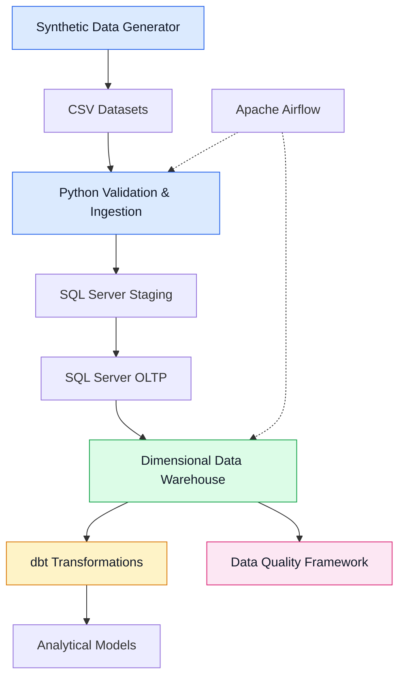

# ✈️ AeroLogix – Airline Operations & Flight Intelligence Platform

**An end-to-end data engineering platform for airline operations analytics, built using Python, Microsoft SQL Server, dbt, Apache Airflow and Docker.**

AeroLogix is an educational data engineering project that demonstrates how fictional airline operational data can be generated, validated, ingested, transformed and organized into an analytical data warehouse.

The platform models airline operations across airports, aircraft, routes, flights and bookings, enabling structured analysis of flight performance, delays, booking activity and revenue.

---

## 📌 Project Overview

Airline operations generate data across multiple business processes, including flight scheduling, airport operations, aircraft utilization and passenger bookings.

AeroLogix demonstrates how these operational datasets can be integrated into a structured data platform using modern data engineering practices.

The project implements a complete data pipeline covering:

- Synthetic data generation.
- Data validation and ingestion.
- Relational database management.
- Dimensional data modelling.
- Historical data management.
- Analytical transformations.
- Workflow orchestration.
- Data quality validation.

**Project type:** End-to-End Data Engineering  
**Domain:** Airline Operations & Aviation Analytics  
**Data:** Deterministic synthetic airline datasets

---

## 🏗️ Architecture



### Data Pipeline

1. Generate deterministic synthetic airline datasets.
2. Validate CSV schemas, data types, required values and business keys.
3. Load validated records through Python into SQL Server staging.
4. Apply operational data into relational OLTP tables.
5. Populate dimensional warehouse tables.
6. Transform operational sources using dbt.
7. Execute data quality checks.
8. Coordinate ingestion and warehouse loading through an Apache Airflow DAG.

---

## 🛠️ Technology Stack

| Category | Technology |
|---|---|
| Programming Language | Python 3.11+ |
| Database | Microsoft SQL Server 2022 Developer |
| Query Language | T-SQL |
| Data Processing | Python, pyodbc |
| Data Validation | pytest |
| Data Transformation | dbt Core |
| dbt Adapter | dbt-sqlserver |
| Workflow Orchestration | Apache Airflow |
| Containerization | Docker, Docker Compose |
| Configuration | python-dotenv |
| Version Control | Git, GitHub |

---

## 📂 Project Structure

```text
AeroLogix-Airline-Operations-Flight-Intelligence/
│
├── airflow/
│   ├── dags/
│   │   └── aerologix_daily.py
│   └── requirements.txt
│
├── data/
│   └── raw/
│       ├── airports.csv
│       ├── aircraft.csv
│       ├── routes.csv
│       ├── flights.csv
│       └── bookings.csv
│
├── dbt/
│   ├── models/
│   ├── snapshots/
│   ├── tests/
│   └── dbt_project.yml
│
├── docs/
│   ├── ARCHITECTURE.md
│   ├── DATA_MODEL.md
│   ├── DATA_DICTIONARY.md
│   ├── PIPELINE_GUIDE.md
│   ├── SETUP_GUIDE.md
│   ├── TESTING.md
│   ├── PROJECT_AUDIT.md
│   ├── PHASE_2_VALIDATION_REPORT.md
│   ├── FINAL_PROJECT_REPORT.md
│   └── PROJECT_CLOSURE_CHECKLIST.md
│
├── scripts/
│   ├── apply_sql.py
│   └── load_warehouse.py
│
├── sql/
│   ├── oltp/
│   ├── warehouse/
│   └── analytics/
│       └── data_quality.sql
│
├── src/
│   └── aerologix/
│       ├── generate.py
│       └── load.py
│
├── tests/
│
├── .env.example
├── .gitignore
├── docker-compose.yml
├── pyproject.toml
└── README.md
```

*The tree highlights the main project components; consult the repository for the complete file structure.*

Phase 3 reliability assets include `.github/workflows/ci.yml`, numbered SQL migrations, quarantine export and environment-check scripts, the dbt singular tests, and the Airflow deployment guide.

---

## 📊 Synthetic Dataset

AeroLogix uses deterministic fictional datasets to simulate airline operations.

| Dataset | Description | Records |
|---|---|---:|
| Airports | Airport reference information | 8 |
| Aircraft | Aircraft information | 6 |
| Routes | Directed airport routes | 10 |
| Flights | Flight operational records | 120 |
| Bookings | Passenger booking records | 1,200 |
| **Total** | | **1,344** |

### Dataset characteristics

- Reproducible data generation using a configurable random seed.
- Configurable date ranges and record counts.
- Consistent relationships between airports, routes, aircraft, flights and bookings.
- Realistic fictional flight and booking statuses.
- Validation of booking references and business keys.
- Capacity-aware synthetic flight generation.

**Note:** All generated records are fictional and are not actual airline operational or passenger records.

---

## 🗄️ Database Architecture

The platform uses Microsoft SQL Server to manage operational data and analytical workloads.

### OLTP Database

The operational database models:

- Airports.
- Aircraft.
- Routes.
- Passengers.
- Flights.
- Bookings.
- Maintenance events.

Relational integrity is maintained through primary keys, foreign keys, unique constraints and check constraints.

### Data Warehouse

The dimensional warehouse contains the following dimensions:

| Dimension | Purpose |
|---|---|
| DimDate | Calendar and date analysis |
| DimAirport | Airport analysis |
| DimAircraft | Aircraft analysis |
| DimRoute | Route analysis |
| DimPassenger | Passenger analysis |

### Fact Tables

| Fact Table | Grain |
|---|---|
| FactFlight | One record per source FlightId |
| FactBooking | One record per source BookingId |
| FactDailyFlightSnapshot | One record per service date and FlightId |

The warehouse uses surrogate keys for dimensional relationships and natural keys for source identification.

### Slowly Changing Dimensions

AeroLogix demonstrates different approaches to managing changing dimension attributes.

| Dimension | SCD Strategy |
|---|---|
| Airport | Type 2 |
| Aircraft | Type 1 and Type 3 |
| Passenger loyalty | Type 1 |

**Historical data limitation:** Airport source extracts do not provide authoritative effective timestamps. Therefore, complete historical as-of attribution cannot be established from the available source data alone.

---

## 🔄 Data Ingestion with Python

The Python ingestion module handles the movement of synthetic CSV data into SQL Server.

Key capabilities:

- Explicit CSV-to-SQL column mappings.
- Required-column and schema validation.
- Data type normalization.
- NULL and timestamp handling.
- Duplicate business-key detection.
- Parameterized SQL execution.
- Configurable batch processing.
- Transaction management.
- Rollback on failure.
- Structured logging.
- Database connection cleanup.
- Per-run UUIDs and SQL Server execution audit records.
- Per-feed accepted/rejected counts and estimated inserted/updated counts.
- JSONL quarantine files for invalid records while valid rows continue.
- Idempotent retry behavior for source-key upserts.

All five feeds are schema-checked before database writes. Invalid data rows are retained with rejection reasons under `data/quarantine/`; valid records continue. Schema/header errors stop the run because field mapping cannot be trusted. See [Pipeline Guide](docs/PIPELINE_GUIDE.md) for recovery and the limits on inserted/updated count semantics.

---

## ⚙️ Data Transformation with dbt

The dbt project provides SQL-based transformation capabilities over operational data.

Implemented components include:

- Source definitions.
- Staging models.
- Analytical marts.
- Airport snapshots.
- Generic data tests.
- Source and model documentation.
- Business-grain singular tests for flight summary and booking revenue marts.

The project includes two staging views, two marts and one airport snapshot.

Database-dependent dbt operations require a reachable SQL Server instance and a valid dbt profile.

---

## ⏱️ Workflow Orchestration with Apache Airflow

The AeroLogix daily DAG coordinates the pipeline through two primary tasks:

1. Python-based operational data ingestion.
2. SQL Server warehouse loading.

The DAG includes:

- Task dependencies.
- Three retries.
- Five-minute retry delays.
- One-hour execution timeout.
- Maximum one active DAG run.
- Execution logging.
- SQL Server connection configuration.

Airflow is deployed separately from the SQL Server Docker Compose service.
See [Airflow deployment notes](airflow/README.md) for Python constraints, environment setup and the SQL Server connection.

---

## 🧪 Data Quality Framework

Data quality is an important part of the AeroLogix pipeline.

The SQL data quality framework checks:

- Duplicate primary and business keys.
- Orphan relationships.
- Missing required values.
- Invalid status values.
- Invalid dates.
- Invalid fare values.
- Aircraft capacity violations.
- Unresolved dimension references.
- Fact table uniqueness.
- SCD Type 2 validity overlap.
- Snapshot consistency.

The SQL quality report provides:

- Test name.
- Records checked.
- Failed records.
- Pass/fail status.
- Execution timestamp.

Invalid source records are rejected by the ingestion validation process rather than silently accepted.

---

## 🚀 Getting Started

### Prerequisites

Install the following:

- Python 3.11 or later.
- Docker Desktop.
- Microsoft ODBC Driver 18 for SQL Server.
- SQL Server command-line utilities (`sqlcmd`).
- Git.

### 1. Clone the Repository

```bash
git clone https://github.com/charanreddy0006/aerologix-airline-data-platform.git

cd aerologix-airline-data-platform
```

### 2. Configure Environment Variables

For PowerShell:

```powershell
Copy-Item .env.example .env
```

Update `.env` with strong local SQL Server credentials.

Configure matching values for `SA_PASSWORD` and `SQLSERVER_PASSWORD` as required by the project configuration.

Never commit your `.env` file.

### 3. Start SQL Server

```bash
docker compose up -d
```

Verify that the SQL Server container is running:

```bash
docker compose ps
```

### 4. Create a Python Virtual Environment

```powershell
python -m venv .venv

.venv\Scripts\Activate.ps1
```

### 5. Install Python Dependencies

```bash
python -m pip install --upgrade pip

python -m pip install -e ".[test]"
```

### 6. Validate settings and initialize/upgrade the SQL Server database

From the project root:

```bash
python scripts/check_env.py

python scripts/upgrade_database.py
```

### 7. Generate and Load Data

```bash
python -m aerologix.generate

python -m aerologix.load --data data/raw --batch-size 1000
```

### 8. Load the Data Warehouse

```bash
python scripts/load_warehouse.py
```

### 9. Execute Data Quality Checks

```powershell
sqlcmd -C -S localhost,1433 -U sa -P "$env:SQLSERVER_PASSWORD" -b -i sql/analytics/data_quality.sql
```

---

## 🧰 dbt Setup

Configure the dbt SQL Server profile using:

`dbt/profiles.yml.example`

Set the appropriate connection details through the local dbt configuration.

From the `dbt/` directory, execute:

```bash
dbt deps

dbt debug

dbt parse

dbt compile

dbt test

dbt run
```

A reachable SQL Server database is required for connection-dependent commands.

---

## 🧪 Running Tests

From the project root:

### Python compilation

```bash
python -m compileall -q src tests scripts airflow/dags
```

### pytest

```bash
python -m pytest -q
```

### unittest

```bash
python -m unittest discover -s tests -v
```

The read-only SQL Server integration test requires `AEROLOGIX_TEST_DSN` pointing to a separately provisioned disposable SQL Server instance. Never point integration tests at production or the original project database. Live database and Airflow execution are not performed by offline CI.

---

## 📋 Validation Status

**Prior validation date:** November 15, 2026. Phase 3 implementation results are recorded in `docs/PHASE_3_IMPLEMENTATION_REPORT.md`.

| Validation | Result |
|---|---|
| Python compilation | PASS |
| pytest | 9 passed, 1 skipped |
| unittest | 4 tests, 1 skipped |
| CSV validation | PASS |
| Generator repeatability | PASS |
| Docker Compose configuration | PASS |
| YAML validation | PASS |
| Markdown local links | PASS |
| dbt parse | PASS |
| SQL Server integration | BLOCKED |
| Warehouse execution | BLOCKED |
| SQL data quality execution | BLOCKED |
| dbt database operations | BLOCKED |
| Airflow DAG execution | BLOCKED |
| Phase 3 CI workflow | See Phase 3 report |

### Validation Notes

The offline tests and configuration checks were successfully executed.

Live SQL Server operations could not be completed because the SQL Server endpoint was unavailable in the validation environment.

Airflow was not installed, so DAG execution and scheduler-level behavior remain unverified.

The complete validation evidence is documented in:

- `docs/PHASE_2_VALIDATION_REPORT.md`
- `docs/FINAL_PROJECT_REPORT.md`
- `docs/PROJECT_CLOSURE_CHECKLIST.md`

**Current project status: READY WITH INFRASTRUCTURE LIMITATIONS**

---

## ⚠️ Known Limitations

- Live SQL Server integration has not been verified in the final review environment.
- Warehouse loading and SQL data quality execution require a running SQL Server instance.
- dbt compile, test and run require database connectivity.
- Airflow is configured as a separate deployment and has not undergone live execution validation.
- The original create-if-missing scripts remain the baseline; numbered additive migrations now track later schema changes.
- Migrations are forward-only; upgrades require a database/volume backup and reviewed compensating migration for rollback.
- Airport source data does not provide authoritative historical effective dates.
- No source feeds currently provide crew, airline ownership or maintenance event records.
- Quarantine is local JSONL, not a centralized retention-managed SQL store. Review, correction and export are operator steps.

---

## 🔮 Future Enhancements

Potential future improvements include:

- Centralized, retention-managed quarantine beyond the current local JSONL workflow.
- Effective-dated source records.
- Additional airline and crew datasets.
- Expanded operational analytics.
- Fully provisioned Airflow deployment.

These are future opportunities rather than claims about existing functionality.

---

## 📚 Documentation

Detailed technical documentation is available in the `docs/` directory.

| Document | Description |
|---|---|
| ARCHITECTURE.md | Platform architecture |
| DATA_MODEL.md | Database and dimensional modelling |
| DATA_DICTIONARY.md | Table and column descriptions |
| PIPELINE_GUIDE.md | Pipeline execution workflow |
| SETUP_GUIDE.md | Environment setup |
| TESTING.md | Testing instructions |
| PROJECT_AUDIT.md | Initial technical audit |
| PHASE_2_VALIDATION_REPORT.md | Integration validation evidence |
| FINAL_PROJECT_REPORT.md | Final project summary |
| PROJECT_CLOSURE_CHECKLIST.md | Project completion checklist |
| PHASE_3_IMPLEMENTATION_REPORT.md | Phase 3 changes, checks and remaining limitations |

---

## 🎯 Learning Objectives

This project demonstrates practical implementation of:

- Python-based data engineering.
- SQL Server database development.
- Relational database modelling.
- Dimensional data modelling.
- Slowly Changing Dimensions.
- Batch data ingestion.
- SQL-based transformations.
- dbt testing and modelling.
- Apache Airflow orchestration.
- Docker-based infrastructure.
- Data quality and validation.
- Technical documentation and reproducibility.

---

## 👨‍💻 Author

**Mukka Charan Kumar Reddy**

B.Tech – Computer Science & Engineering  
Specialization: Artificial Intelligence & Machine Learning

GitHub: [@charanreddy0006](https://github.com/charanreddy0006)

---

## 📄 License

This project is intended for educational and portfolio purposes.

A formal open-source license should be added to the repository before redistribution.

---

**AeroLogix – Turning Airline Operational Data into Structured Intelligence.** ✈️
