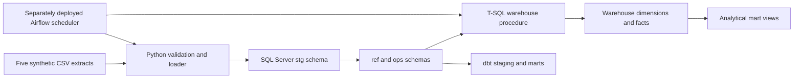
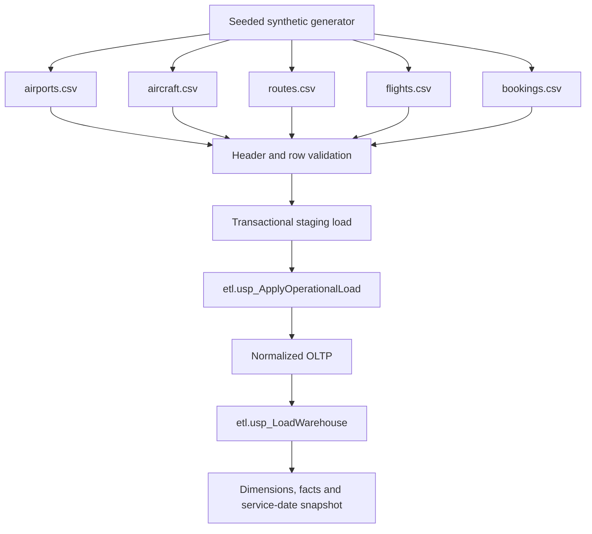
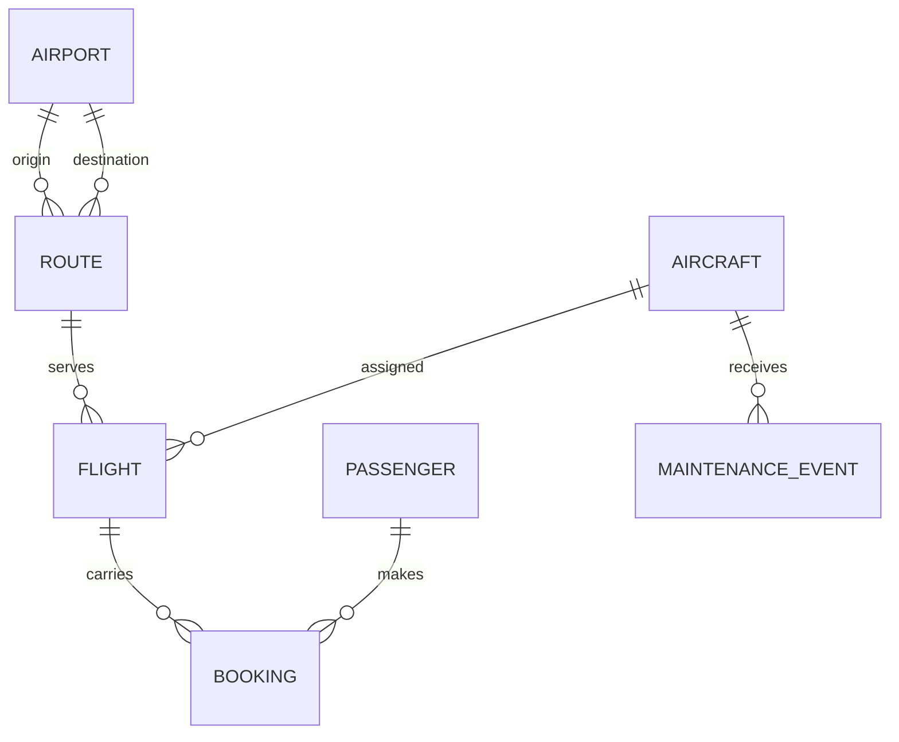
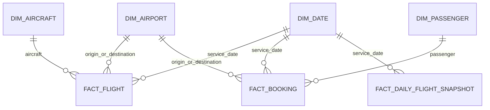

# AeroLogix architecture

## End-to-end architecture

## Data flow

## OLTP physical ERD

Airport and aircraft are reference data; routes are directed. Airline and crew are not modeled because extracts contain no ownership or crew assignments. Maintenance is modeled but has no generated feed.

## Warehouse star schema

FactFlight is one row per FlightId; FactBooking is one row per BookingId; FactDailyFlightSnapshot is one current aggregate per service date and flight. Reruns refresh that service-date aggregate; it is not a load-date history. Airport is SCD2, aircraft is SCD1 with previous type SCD3, and passenger loyalty is SCD1. Airport effective dates are processing-time UTC because extracts contain no effective timestamp, so historical as-of airport attribution is limited.

## Airflow workflow

Compose starts SQL Server only. Airflow needs a separate scheduler, metadata database, matching constraints, and an `aerologix_sqlserver` connection. See [setup](SETUP_GUIDE.md) and [pipeline](PIPELINE_GUIDE.md).
